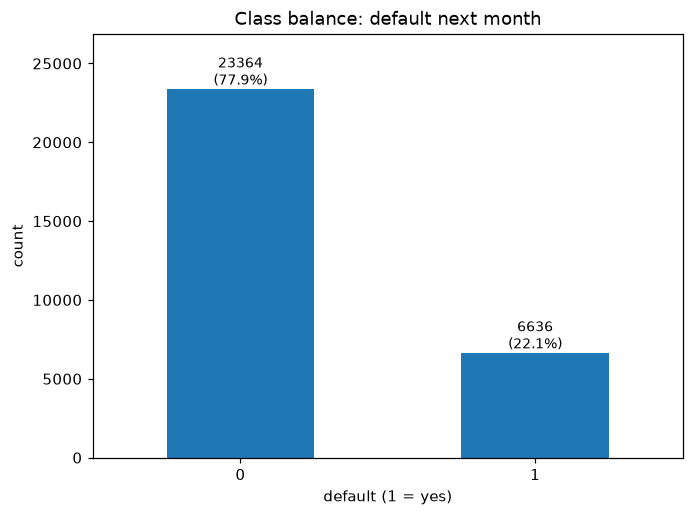
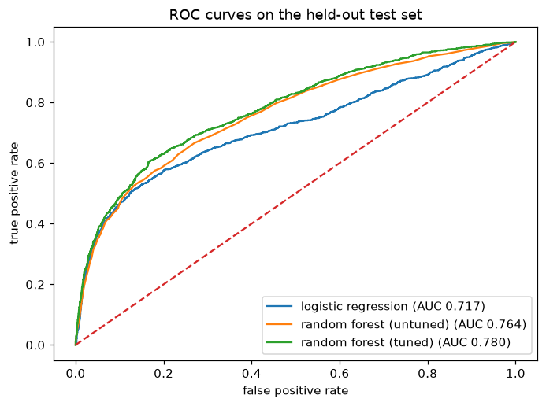

# Machine Learning Analysis Report - Credit Card Default Prediction

3 November 2026

## Overview

This report addresses a supervised binary classification task: predicting which clients will default on their next month's credit card payment. The data comes from the Default of Credit Card Clients dataset (Yeh & Lien, 2009; Yeh, 2009), and it's publicly available through the UCI Machine Learning Repository at https://doi.org/10.24432/C55S3H.

This analysis compares logistic regression with a random forest; the tuned random forest reaches a ROC AUC of 0.78 and an accuracy of 0.82 on a held-out test set. Lowering the decision cut-off from the standard 0.5 to 0.174 raises the share of defaulters caught from 36% to 72% and reduces the assumed error cost from 4,448 to 3,347 units on the 6,000 test clients.

## Dataset Description

The dataset covers 30,000 clients of a credit card issuer in Taiwan, described by 24 columns that record six months of payment history in 2005. The target, default, indicates whether each client missed the following month's payment. In total, 6,636 clients defaulted, about 22% of the sample.

The 23 features cover:

- credit limit (X1)
- demographics (X2 to X5)
- repayment statuses (X6 to X11)
- bill statements (X12 to X17)
- previous payments (X18 to X23)

Even though the dataset has no missing values, it does have duplicates, among which 35 rows are exact copies of another row; after the split, 14 test rows (about 0.2% of the test set) also have an exact twin in the training set, all of which were kept in the analysis.

Some of the categorical features also carry irregularities: education has undocumented codes 0, 5, and 6, and marriage an undocumented 0, so rather than just dropping these rows, I grouped them into the documented "others" categories.

I left both the repayment status of -2, which the documentation does not explain, and the negative bill amounts that appear in about 6% of rows unchanged.

**Figure 1.** Class balance of the full dataset: 23,364 non-defaulters and 6,636 defaulters. Each bar shows its count and share of the 30,000 rows.

## Modeling Approach

After grouping the undocumented categories, I split the dataset into two sets, one with 24,000 training rows and another with 6,000 test rows, keeping the default rate intact in each. Each model runs inside a pipeline that fits all of its preprocessing on the training data alone, turning the three categorical features into indicator columns and standardizing the 20 numeric features. A fixed random seed keeps every run reproducible.

Accuracy alone is not enough: because most clients did not default, a model that always predicts "no default" already achieves 0.7788 accuracy, so a useful model has to beat that trivial guess.

I chose ROC AUC to compare the models because it measures how well they rank defaulters above non-defaulters without requiring a particular decision cut-off (scikit-learn developers, n.d.-a). With only 22% of clients defaulting, however, ranking can flatter a model, so the evaluation also reports precision, recall, and F1 at the standard and cost-tuned cut-offs, where the precision-recall trade-off is visible.

In five-fold cross-validation, logistic regression achieved a ROC AUC of 0.7266 (standard deviation 0.0084 across folds), while a 100-tree random forest achieved 0.7617 (standard deviation 0.0078). Since the forest scored higher, I tuned it further over a small grid of 100 or 200 trees and a maximum depth of 10 or 20. Of the four combinations, 200 trees at depth 10 scored best, with a cross-validated ROC AUC of 0.7795 (standard deviation 0.0071). The test set was not used for model selection or tuning.

The decision cut-off was selected on the training folds using TunedThresholdClassifierCV (scikit-learn developers, n.d.-c). Its cost score assumes that a false alarm costs one unit and a missed defaulter costs five; this is an illustrative assumption, not a measured bank loss. The selected cut-off is then evaluated once on the test set.

## Results

At the standard cut-off of 0.5, the tuned forest achieved the following on the test set:

- accuracy: 0.8220
- precision: 0.6837
- recall: 0.3632
- F1: 0.4744
- ROC AUC: 0.7799

The confusion matrix at the same cut-off:

- 4,450 clients correctly cleared (true negatives)
- 482 defaulters correctly flagged (true positives)
- 223 clients wrongly flagged (false positives)
- 845 defaulters missed (false negatives)

In total, the model flagged roughly one in ten test clients. Figure 2 compares the test-set ROC curves of the logistic regression, the untuned forest, and this tuned forest.

**Figure 2.** ROC curves on the held-out test set for the logistic regression, the untuned forest, and the tuned forest, whose curve reaches AUC 0.7799.

### The cost-tuned cut-off

Lowering the cut-off from 0.5 to 0.174 makes the model flag far more people, and the trade-off is visible:

- recall: 0.3632 → 0.7159 (it catches 950 of the 1,327 test defaulters instead of 482)
- precision: 0.6837 → 0.3939 (fewer than half of the flagged clients actually default)
- F1: 0.4744 → 0.5082

With a missed default costing 5 units and a false alarm costing 1, the 1,239 extra false alarms cost 1,239 units, but the 468 extra defaulters caught save 2,340. Therefore the total assumed cost drops from 4,448 to 3,347, a saving of 1,101 units on the same 6,000 test clients.

### Feature Importance

The most recent repayment status (X6) carries the model: shuffling its values costs 0.0694 ROC AUC (standard deviation 0.0031), roughly four times the loss from the next repayment feature (X7, 0.0177) and six times the loss from the credit limit (X1, 0.0120). Permutation importance works by breaking one feature at a time and measuring how far the test ranking falls, so these scores are losses, not abstract weights. I used permutation rather than the forest's built-in impurity scores because impurity can overstate features with many possible split points (scikit-learn developers, n.d.-b).

The logistic regression points the same way: a higher repayment status raises the modeled odds of default (coefficient +0.6401, about 1.9 times per standard deviation), while the grouped "others" education category lowers them (coefficient -1.0377, about 0.35 times). Both are associations inside the model, not evidence that either feature causes default.

### Duplicate Check

Duplicates could also flatter the score by letting the model memorize repeated clients. I retrained the same tuned configuration after removing the 21 exact duplicates inside the training set (23,979 rows remain), and the test ROC AUC barely moved, from 0.7799 to 0.7796, so duplicated training rows are not driving the headline number. The check does not touch the 14 test rows that mirror a training row; testing those would mean removing duplicates before the split, which this analysis does not do.

### Group Flagging Rates

The tables report flagging at the tuned cut-off of 0.174 for the two recorded demographic variables: sex and education. Each row gives a group's size, its false-positive rate (the share of non-defaulters in the group who were wrongly flagged), and the share of all its clients who were flagged. The "all" row repeats those figures for the whole test set, giving each group a baseline to compare against.

**By sex**

| Group | n | FPR | flagged |
|---|---|---|---|
| male | 2,436 | 0.3389 | 0.4314 |
| female | 3,564 | 0.2958 | 0.3819 |
| all | 6,000 | 0.3129 | 0.4020 |

**By education**

| Group | n | FPR | flagged |
|---|---|---|---|
| graduate school | 2,109 | 0.2860 | 0.3651 |
| university | 2,825 | 0.3217 | 0.4081 |
| high school | 975 | 0.3626 | 0.4810 |
| others | 91 | 0.2073 | 0.2198 |
| all | 6,000 | 0.3129 | 0.4020 |

The "others" education group has only 91 members. Its rates are shown for completeness, but the small group size makes comparisons less reliable.

## Interpretation for a Non-Technical Audience

The model ranks clients by their likelihood of default and flags those whose scores meet the chosen cut-off. It was trained on 24,000 records from one issuer and tested on a separate set of 6,000 records.

The cut-off is the bar a client's score must clear to be flagged. At the standard 0.5 bar, the model caught about 4 in 10 defaulters in the test set; lowering the bar to 0.174 caught about 7 in 10, but also flagged so many safe clients that fewer than half of the flags were correct. The lower bar reduced the assumed cost of mistakes in this test, though that result depends on counting a missed default as five times as costly as a false alarm.

The strongest signal in this model was the most recent repayment status. The flags were not spread evenly across groups: under the lower bar, about 43% of men were flagged for review against 38% of women, and about 48% of clients with only a high-school education against 40% overall. Gaps that size need investigating before the model is used on real clients. Because the results describe one issuer's records from 2005, they say nothing certain about any individual client today.

No cut-off is universally right. A bank with different cost estimates should choose the cut-off on its own training data rather than reuse 0.174. Any real-world use should wait for fresh validation on current data and for the fairness audit proposed below, since records from 2005 cannot speak for today's applicants.

## Limitations and Potential Bias

### Generalization

The dataset covers six months of 2005 and comes from one issuer in Taiwan. The results may not generalize to other issuers, markets, or years without further testing (Yeh & Lien, 2009).

### Duplicate leakage

Fourteen test rows have exact matches in the training set, which could make the test score overly optimistic. Removing duplicates within the training set had little effect on ROC AUC, but that check leaves cross-set matches in place. A further test with duplicates kept together or removed before splitting would better assess the overlap.

### Fairness

The dataset reflects the issuer's historical lending decisions, and sex is recorded as a binary field. On the test set, the false-positive rate was 0.3389 for men and 0.2958 for women; their flagged shares were 0.4314 and 0.3819, respectively.

These differences do not by themselves explain why they occur or establish discrimination. Historical decisions and proxy variables are possible sources of bias discussed by Mehrabi et al. (2021), but this analysis does not determine whether they caused the observed differences.

The analysis reports group rates but does not mitigate the differences. I would follow it with a dedicated fairness audit, including an examination of protected attributes and proxies, enough data to assess smaller groups, and consideration of group-aware thresholds where justified and lawful.

### Model and tuning limits

Correlated payment-history features can share permutation importance, making individual scores harder to interpret. The forest search covered only four settings, so its winner is not a proven optimum. The 0.174 cut-off also depends on the assumed one-to-five error cost ratio; a bank using different costs would need to select a new cut-off using its own training data.

## References

Mehrabi, N., Morstatter, F., Saxena, N., Lerman, K., & Galstyan, A. (2021). A survey on bias and fairness in machine learning. *ACM Computing Surveys*, 54(6), Article 115. https://doi.org/10.1145/3457607

scikit-learn developers. (n.d.-a). Metrics and scoring: Quantifying the quality of predictions. scikit-learn User Guide. https://scikit-learn.org/stable/modules/model_evaluation.html

scikit-learn developers. (n.d.-b). Permutation feature importance. scikit-learn User Guide. https://scikit-learn.org/stable/modules/permutation_importance.html

scikit-learn developers. (n.d.-c). Post-tuning the decision threshold for cost-sensitive learning. scikit-learn Example Gallery. https://scikit-learn.org/stable/auto_examples/model_selection/plot_cost_sensitive_learning.html

Yeh, I.-C. (2009). Default of Credit Card Clients [Dataset]. UCI Machine Learning Repository. https://doi.org/10.24432/C55S3H

Yeh, I.-C., & Lien, C.-H. (2009). The comparisons of data mining techniques for the predictive accuracy of probability of default of credit card clients. *Expert Systems with Applications*, 36(2), 2473-2480. https://doi.org/10.1016/j.eswa.2007.12.020
